# RoomSathi Architecture and Data Flows

This document explains how requests move from the browser through the React client and Express API to MongoDB. The diagrams describe the current development architecture and the main implemented workflows.

## System boundaries

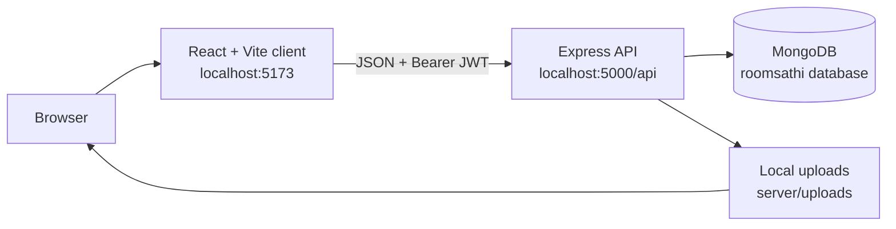

## 1. Application startup and session restoration

The browser loads the Vite client. React mounts the application, creates the authentication context, and checks whether a previous JWT exists in local storage.

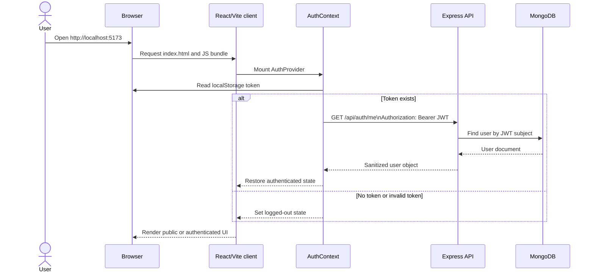

## 2. Student registration and Gmail validation

Gmail validation happens in the browser for fast feedback and again on the server as the authoritative rule.

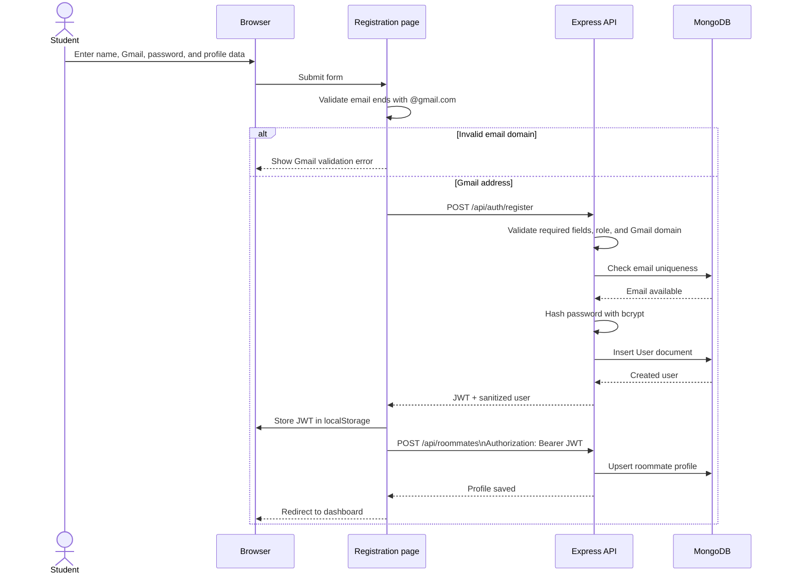

## 3. Login

The API returns a token and user object. The client stores the token and keeps the user object in AuthContext.

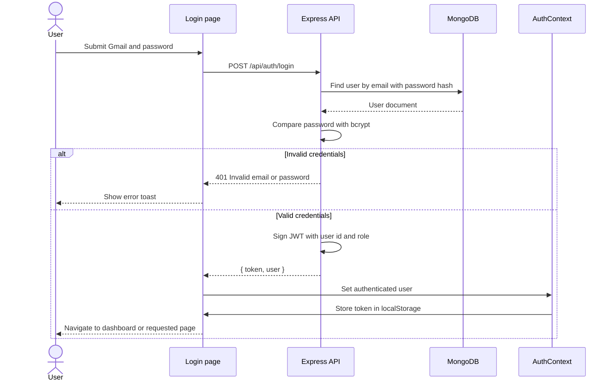

## 4. Room discovery and filtering

Room filters are sent to the API. Optional parameters are removed before the query string is created, so the server never receives literal `undefined` filters.

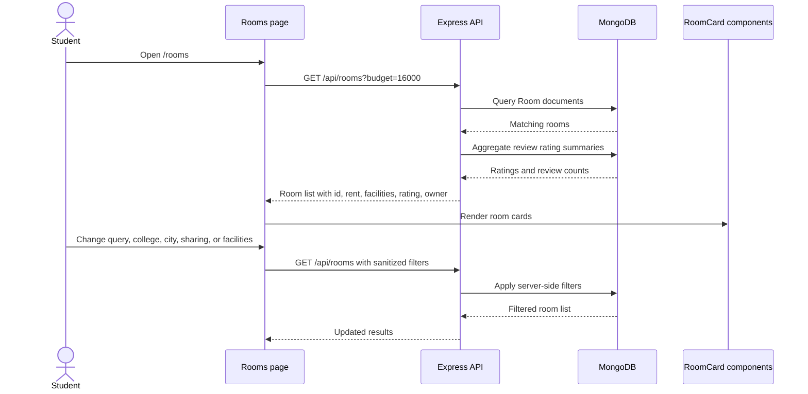

Supported room criteria:

- Search text across room name, city, and college
- Maximum rent
- City
- College
- Sharing type
- Verified-only flag
- All selected facilities

## 5. Room details, views, and reviews

```mermaid
sequenceDiagram
    actor Student
    participant Details as RoomDetailsPage
    participant API as Express API
    participant DB as MongoDB

    Student->>Details: Open /rooms/{roomId}
    Details->>API: GET /api/rooms/{roomId}
    Details->>API: GET /api/rooms/{roomId}/reviews
    API->>DB: Load room and owner
    API->>DB: Load room reviews and rating summary
    DB-->>API: Room, owner, reviews
    API-->>Details: Room details and review data
    Details->>Browser: Record recent room id in localStorage
    Student->>Details: Click Book Visit
    Details->>API: POST /api/visit-requests
    API->>DB: Create visit request
    API->>DB: Create owner notification
    DB-->>API: Visit request and notification saved
    API-->>Details: Visit request created
```

## 6. Wishlist persistence

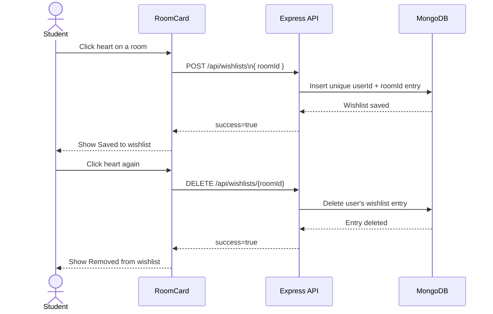

The profile page loads saved rooms with `GET /api/wishlists`.

## 7. Roommate matching

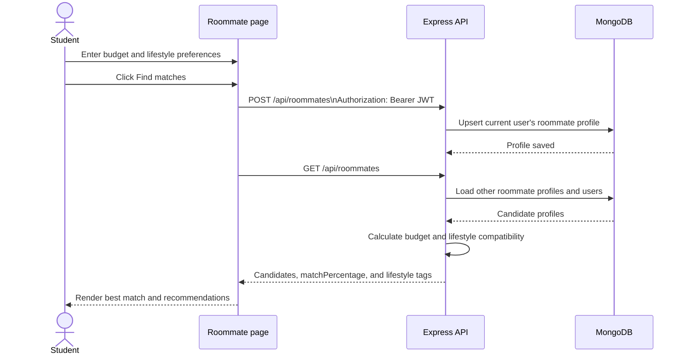

## 8. Notifications and visit-request status

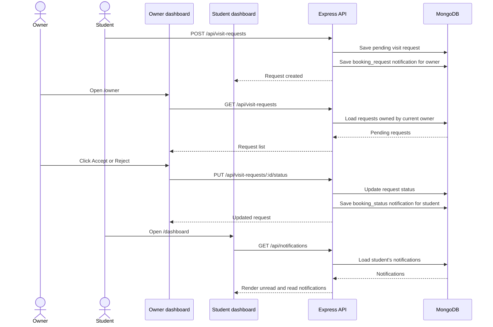

## 9. Owner analytics

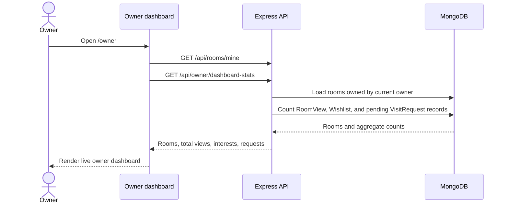

The current room-detail flow records recent room ids in browser local storage. The server-side `RoomView` collection is seeded for testing and is ready for a dedicated view-event endpoint.

## 10. Image upload storage

The current development implementation stores images on the API host. Production should replace this with object storage.

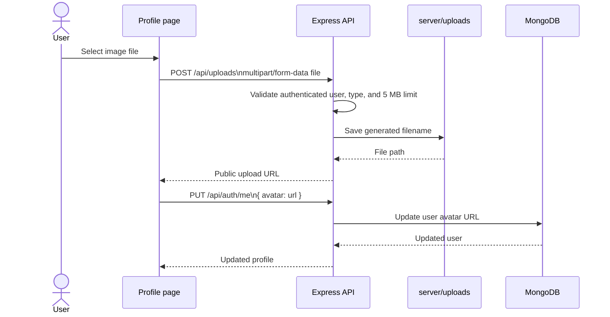

## 11. Password reset

The reset token is hashed in MongoDB and expires after 15 minutes. The current local-development endpoint returns a token so the flow can be tested without an email provider.

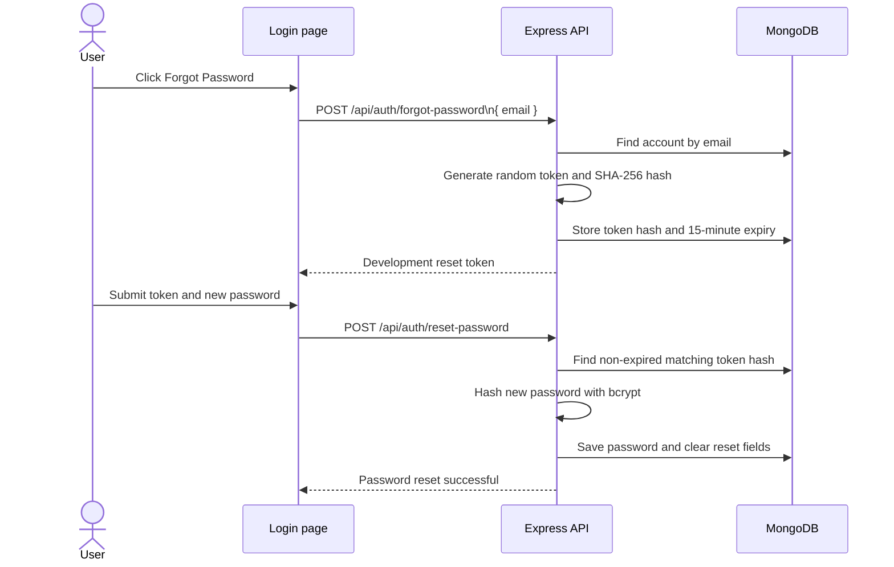

In production, return a generic response and send the reset link through a transactional email provider instead of displaying the token.

## 12. Authorization boundaries

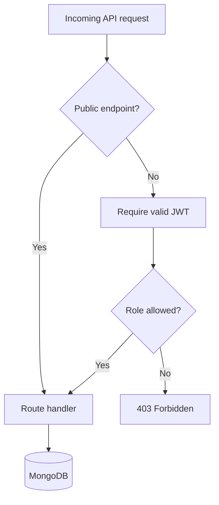

- Public room browsing and room reviews do not require authentication.
- Student profile, roommate, wishlist, notifications, uploads, and visit creation require a JWT.
- Owners can manage their own rooms and process their own visit requests.
- Admins can view admin statistics and perform administrative room operations.
- Password hashes, reset hashes, Aadhaar, and JWT secrets are never returned to the browser.

## 13. Production notes

- Use MongoDB Atlas or a secured MongoDB deployment.
- Replace `server/uploads/` with S3, Cloudinary, or another object-storage provider.
- Configure an email provider for password reset delivery.
- Add rate limiting and Helmet before public deployment.
- Put the API behind HTTPS and a reverse proxy.
- Never expose MongoDB port `27017` publicly.
- Keep `.env` files and uploaded files out of version control.
